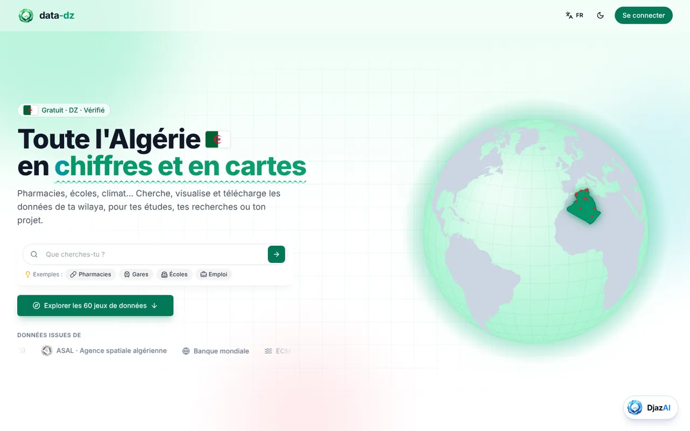
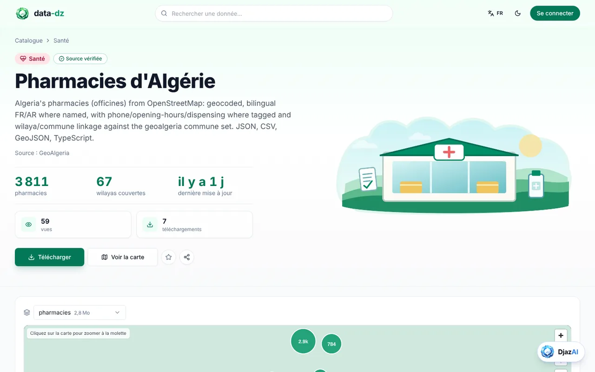
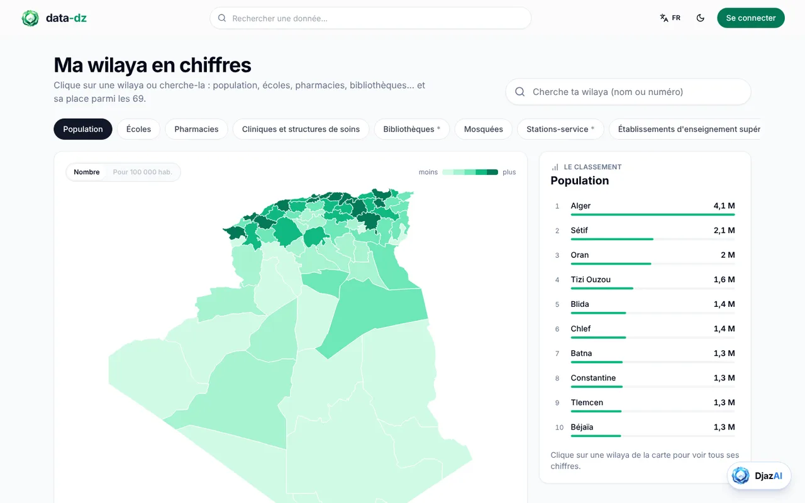
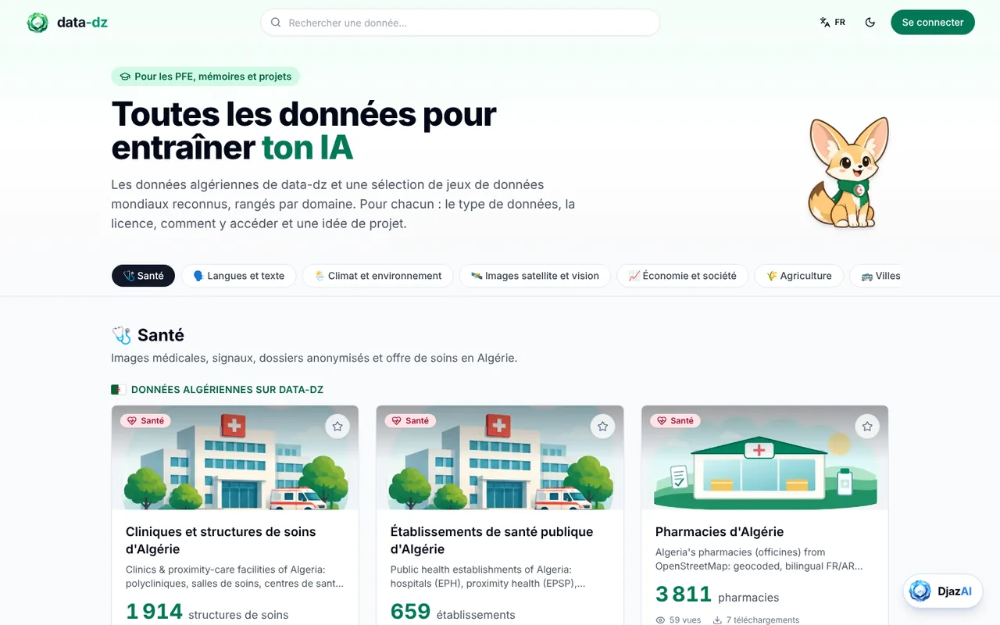
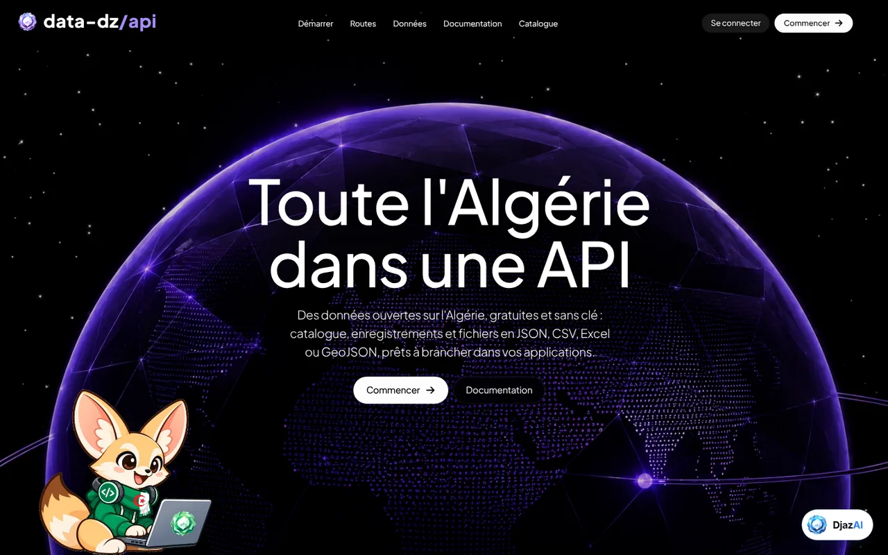
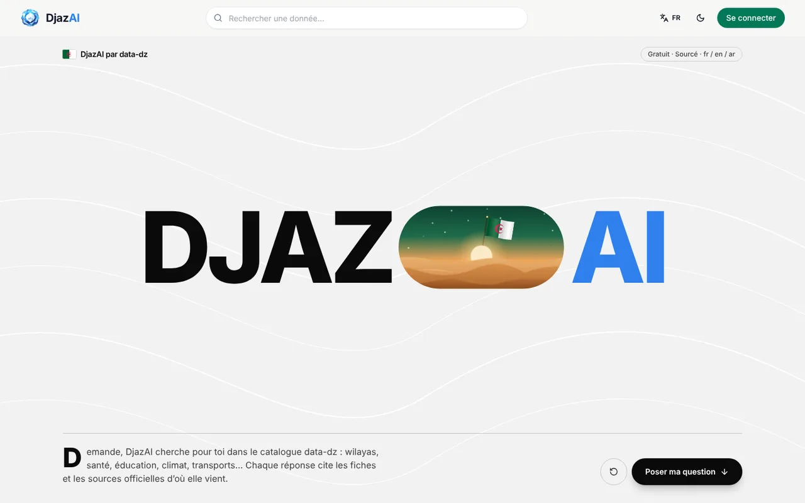

<div align="center">


# data-dz

**Toute l'Algérie en chiffres et en cartes 🇩🇿**

Le portail open source des données sur l'Algérie, porté par [New Algeria](https://newalgeria.org).
Pharmacies, écoles, climat, population, économie… à chercher, visualiser et télécharger gratuitement,
toujours avec leur source et leur licence.

[🌐 data-dz.com](https://www.data-dz.com) · [🔌 API publique](https://www.data-dz.com/api) · [🤖 DjazAI](https://www.data-dz.com/djazai) · [🐛 Signaler un problème](https://github.com/new-algeria/data-dz/issues)




</div>

---

## ✨ Ce que propose le site

| | |
|---|---|
| 🔎 **Catalogue** | Recherche instantanée en français, anglais et arabe, filtres par thématique, tri, défilement infini. |
| 📄 **Fiche d'une donnée** | Carte ou graphique détectés automatiquement, chiffres clés, colonnes, aperçu, source et licence. Téléchargement en **CSV, Excel, JSON ou GeoJSON**. |
| 🗺️ **Ma wilaya en chiffres** | Carte des 69 wilayas, classements par mesure (au total ou pour 100 000 habitants) et une page par wilaya. |
| 🧠 **Données pour l'IA** | Les données algériennes et une sélection de jeux mondiaux reconnus, par domaine, la santé en premier. |
| 🤖 **DjazAI** | Un assistant qui répond à partir du catalogue et cite ses sources. |
| 🔌 **API publique** | Gratuite et sans clé, documentée en OpenAPI : catalogue, enregistrements et fichiers. |
| 👥 **Communauté** | Comptes (email, Google…), profils publics, votes, favoris, commentaires, notifications. Chacun peut **proposer une donnée**, relue par les modérateurs avant sa mise en ligne. |
| 🛠️ **Administration** | Gestion des données, des membres, des rôles et permissions, des synchronisations automatiques et des statistiques. |

Le site est trilingue (l'arabe s'affiche de droite à gauche), en mode clair ou sombre, et respecte le réglage « réduire les animations ».

<table>
  <tr>
    <td></td>
    <td></td>
    <td></td>
  </tr>
  <tr>
    <td align="center">Fiche d'une donnée</td>
    <td align="center">Ma wilaya en chiffres</td>
    <td align="center">Données pour l'IA</td>
  </tr>
  <tr>
    <td></td>
    <td></td>
    <td></td>
  </tr>
  <tr>
    <td align="center">API publique</td>
    <td align="center">DjazAI</td>
    <td></td>
  </tr>
</table>

## 📚 D'où viennent les données

Chaque donnée garde **la licence de sa source**, affichée sur sa fiche. Une partie est renouvelée automatiquement par les robots de l'API :

- **[GeoAlgeria](https://geoalgeria.com)** par Yasser's studio : lieux et équipements (santé, écoles, télécoms…), chaque semaine
- **[OpenStreetMap](https://www.openstreetmap.org/copyright)** (ODbL, citation obligatoire) : chiffres présentés comme des estimations
- **WorldPop** (population des wilayas), **NASA FIRMS** (feux), **USGS** (séismes), **Ember** (électricité), **Copernicus ERA5-Land** et **CAMS** (sécheresse, pollution), **GBIF** (biodiversité), **FMI** et **Banque mondiale** (économie)…
- Les propositions de la communauté, une fois relues

Une erreur dans une donnée GeoAlgeria se signale à la source : [yasserstudio/geoalgeria](https://github.com/yasserstudio/geoalgeria/issues).

## 🏗️ Architecture

```
Navigateur (data-dz : React, site statique sur Vercel)
  ├── API data-dz (https://api.data-dz.com)   → catalogue, fiches, statistiques, téléchargements,
  │                                               conversions, DjazAI, administration des données
  ├── Supabase (Auth + Postgres avec RLS)      → comptes, profils, votes, favoris, commentaires,
  │                                               propositions, modération, notifications
  └── Cloudflare R2 public (web-assets/)       → illustrations uniquement
```

- Le **catalogue et les fichiers passent par l'API** ([dépôt de l'API](https://github.com/new-algeria/api-dz-backend), Hono sur Vercel). Les fichiers sortent par des liens signés de 10 minutes : aucune clé de stockage n'est exposée.
- Le site parle à **Supabase** avec la seule clé *publishable*. Ce qu'un visiteur peut lire ou écrire est décidé par les règles RLS et les fonctions de la base, jamais par le site.
- Les emails (notifications, connexion) partent d'une fonction Edge Supabase via Resend (`supabase/functions/envoyer-email/`).

### Stack

| Rôle | Outils |
|---|---|
| Interface | React 18, TypeScript, Vite 5, Tailwind CSS 3, [shadcn/ui](https://ui.shadcn.com), framer-motion |
| Données | `@tanstack/react-query`, `@supabase/supabase-js` v2 |
| Cartes et graphiques | MapLibre GL, d3-geo, Recharts (chargés à la demande) |
| Langues | i18next, react-i18next |
| Tests | Vitest |

## 🚀 Démarrer en local

**Prérequis** : Node.js 22 et npm.

```bash
git clone https://github.com/new-algeria/data-dz.git
cd data-dz
cp .env.example .env.local
npm install
npm run dev
```

Le site s'ouvre sur **http://localhost:5173** et lit l'API et la base de production (la RLS limite ce qui est visible).

Les variables de `.env.example` sont **publiques par nature** et déjà remplies :

| Variable | Rôle |
|---|---|
| `VITE_SUPABASE_URL` | URL du projet Supabase |
| `VITE_SUPABASE_PUBLISHABLE_KEY` | Clé publishable (`sb_publishable_…`), faite pour le navigateur |
| `VITE_URL_API` | API publique (`https://api.data-dz.com`, ou `http://localhost:3000` avec l'API en local) |
| `VITE_URL_FICHIERS` | Domaine public des illustrations (`https://files.data-dz.com`) |

| Commande | Effet |
|---|---|
| `npm run dev` | Serveur de développement |
| `npm run build` | Site statique dans `dist/`, puis `sitemap.xml` |
| `npm run preview` | Sert `dist/` pour vérifier la build |
| `npm run lint` | ESLint |
| `npm test` | Tests Vitest |

Pour travailler sur la base : `npx supabase start` puis `npx supabase db reset` (applique `supabase/migrations/` et `supabase/seed.sql`, emails visibles dans Mailpit).

## 📁 Structure du dépôt

```
src/
├── pages/            Catalogue, fiche, wilayas, thématiques, Données pour l'IA, DjazAI, API,
│                     profil, membres, propositions, modération, administration, pages légales
├── components/       Par domaine (accueil, catalogue, fiche, wilayas, djazai, communauté, admin…)
│                     et composants génériques shadcn/ui dans ui/
├── lib/              Logique métier pure et testée (*.test.ts), appels à l'API et à Supabase,
│                     routes centralisées (routes.ts)
├── hooks/  contexte/ Hooks React, authentification
└── locales/          Traductions fr / en / ar
supabase/             Migrations SQL, fonction Edge des emails, modèles d'emails, config locale
scripts/              Sitemap, photos des wilayas
public/               Icônes, images de partage, mascotte, logos des sources
docs/captures/        Captures de ce README
CLAUDE.md             Référence technique détaillée (tables, routes, règles de chaque fonctionnalité)
```

## 🤝 Contribuer

Toute aide est bienvenue : code, design, traduction, signalement d'erreurs dans les données. Tu peux aussi **proposer une donnée** directement sur le site.

1. Crée une branche depuis `main`.
2. Respecte les conventions (détails dans [`CLAUDE.md`](./CLAUDE.md)) :
   - noms de variables, fonctions et composants métier **en français** (`chargerCatalogue`, `FicheDonnee`), URL en anglais ;
   - tous les textes visibles traduits en `fr`, `en` et `ar`, jamais en dur ;
   - **aucun chiffre, partenaire ou logo inventé** ;
   - une nouvelle logique dans `src/lib/` arrive avec ses tests ;
   - une migration déjà appliquée en production ne se modifie jamais : toute évolution passe par un nouveau fichier.
3. Vérifie que `npm run lint`, `npm test` et `npm run build` passent.
4. Ouvre une pull request vers `main` avec une capture d'écran si l'interface change. Chaque PR a son aperçu Vercel ; seule `main` part en production.

## 🔒 Sécurité

- Le dépôt est **public** : aucun secret ne doit y être commité (seul `.env.example` est versionné).
- Seule la clé **publishable** de Supabase va dans le site, jamais la clé secrète / `service_role`.
- La RLS est active sur toutes les tables : il ne faut jamais chercher à la contourner.
- Une faille se signale en privé à **admin@newalgeria.org**, pas dans une issue publique.

## 📜 Licences

- **Données** : chacune garde la licence de sa source, indiquée sur sa fiche (attribution GeoAlgeria et OpenStreetMap obligatoire en cas de réutilisation).
- **Code** : aucune licence n'est encore choisie. Tant qu'il n'y a pas de fichier `LICENSE`, le code est consultable mais pas légalement réutilisable.

---

<div align="center">

Un projet de [New Algeria](https://newalgeria.org) · [GitHub](https://github.com/new-algeria) · [X](https://x.com/newalgeria_org) · [admin@newalgeria.org](mailto:admin@newalgeria.org)

</div>
